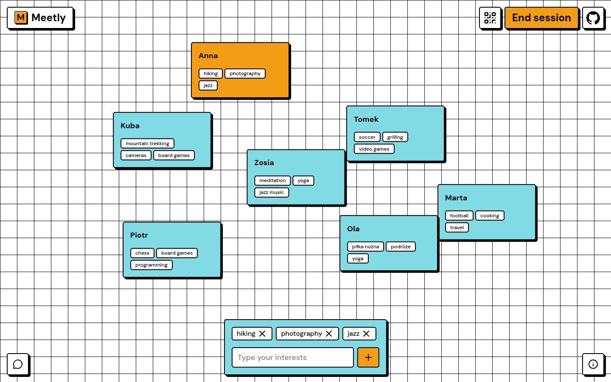

# Meetly

A web app that helps people in one room find each other. A host starts a session, guests join with a 6-digit code or a QR code, and everyone types in their interests. People are shown as cards on a live graph, and the cards of people with similar interests are pulled together.



## Features

- **Host** – creates a session and shows its code and QR code, then joins it like everyone else.
- **Join** – enter the code on the main page or scan the QR code (it opens `/?code=<code>`).
- **Invite** – click the code to copy it, or share the invitation link from the share menu (copy, Discord, WhatsApp or email). During a session, the QR code button in the header opens all of this again.
- **Interests** – pick a name and add your interests. You can add or remove them at any time, but you need at least one, and the same interest can't be added twice. Every change is sent to everyone in the session right away.
- **Graph** – each person is a card, linked to others by how well their interests match (see [Matching](#matching)). Linked cards pull together, and you can drag them. Your card is highlighted and inactive people are greyed out.
- **Chat** – click someone's card, or focus it and press Enter, to send them a direct message. The chat button lists everyone in the session with the last message.
- **Leave or end** – guests can leave a session. The host can end it for everyone.
- **Your sessions** – sessions you joined are saved in the browser and listed on the main page while they still exist, so you can go back to them.

## Matching

Interests are matched by meaning, not spelling, so "football" and "soccer" count as the same interest. The backend embeds every interest with the multilingual [paraphrase-multilingual-MiniLM-L12-v2](https://huggingface.co/Xenova/paraphrase-multilingual-MiniLM-L12-v2) model (run locally with [Transformers.js](https://huggingface.co/docs/transformers.js), quantized to 8 bits) and compares them with cosine similarity.

The strength of the link between two people:

1. For each interest of person A, take the most similar interest of person B.
2. Similarities below `0.6` count as 0. Similarities above it are rescaled to 0–1.
3. Sum these over all of A's interests. Do the same from B to A and take the average.

People with a strength of 0 are not linked.

## Sessions

Sessions are kept in memory on the backend, so they are lost when it restarts.

- A session lasts at most 1 hour.
- A session with nobody connected ends after 5 minutes.
- A person who disconnects is shown as inactive, and their card is removed after 5 minutes unless they come back.
- Only the host can end a session. The backend gives the host a token when the session is created, and the frontend keeps it in `localStorage`.
- Joining gives each person a token that the frontend uses for the WebSocket connections. Both tokens are JWTs valid for 1 hour.
- Each connection can send at most 10 interest updates and 20 messages per 10 seconds.

## File structure

- `backend/` – NestJS API run with Bun.
  - `src/main.ts` – entry point: the `/api` prefix, CORS, the WebSocket adapter and graceful shutdown.
  - `src/common/config.ts` – environment variables, validated at startup with `@nestjs/config`.
  - `src/common/auth/` – tokens for hosts and participants.
  - `src/common/events/` – event bus the slices use to talk to each other (`session.created`, `session.ended`, `participant.registered`, `participant.joined`, `participant.left`).
  - `src/common/exceptions/` – `DomainException`, the base of every slice's exceptions, and the filters that turn it into an HTTP status or a WebSocket error.
  - `src/common/rate-limit.guard.ts` – the `@RateLimit` decorator for gateway handlers.
  - `src/session/handlers/session.controller.ts` – REST endpoints for creating, checking, joining and ending sessions.
  - `src/session/handlers/session.gateway.ts` – WebSocket gateway at `/api/session`: who is connected.
  - `src/session/services/session.service.ts` – sessions and their timeouts.
  - `src/interest/handlers/interest.gateway.ts` – WebSocket gateway at `/api/interests`: answers and broadcasting the graph.
  - `src/interest/services/interest.service.ts` – answers, inactive people and the link strengths.
  - `src/interest/services/embedding.service.ts` – the embedding model and similarity.
  - `src/message/` – direct messages between people in a session, WebSocket gateway at `/api/messages`.
  - `src/*/exceptions/` – each slice's exceptions.
  - `src/*/repositories/` – each slice's storage (in memory for now).
  - `src/health/` – `GET /api/health`.
- `frontend/` – React app built with Vite and Tailwind CSS.
  - `src/App.tsx` – the views and navigation between them.
  - `src/views/` – `Home`, `CreateSession`, `JoinSession` and `Room` (the graph).
  - `src/components/RouteBoundary.tsx` – loading and error states of each view.
  - `src/components/LinkedGraph.tsx` and `src/utils/simulateForces.ts` – the graph and its force simulation.
  - `src/hooks/` – WebSocket connections: `useSession` (presence), `useInterests` and `useMessages`.
  - `src/lib/` – API client, [TanStack Query](https://tanstack.com/query) options, config and `localStorage` helpers.
  - `src/components/ui/` – [neobrutalism.dev](https://www.neobrutalism.dev/) components (shadcn/ui on Base UI).

## Usage

Copy the example environment file first:

```sh
cp .env.example .env
```

Then set `JWT_SECRET`, for example to the output of `openssl rand -hex 32`. Both apps refuse to start while a variable is missing.

| Variable       | Used by  | Description                                    |
| -------------- | -------- | ---------------------------------------------- |
| `PORT`         | backend  | Port of the API (default `8080`).              |
| `CORS_ORIGIN`  | backend  | URL of the frontend allowed to call the API.   |
| `JWT_SECRET`   | backend  | Secret that signs host and participant tokens. |
| `VITE_API_URL` | frontend | Origin of the API (`/api` is appended).        |
| `VITE_URL`     | frontend | URL of the frontend, used in invitation links. |

### Docker Compose

```sh
docker compose up
```

The frontend runs on http://localhost:5173 and the backend on http://localhost:8080. Both reload on changes.

### Checks

CI runs these on every push and pull request:

```sh
cd backend
bun run lint && bun run format:check && bun run typecheck
bun run test       # unit tests
bun run test:e2e   # the whole app, with test/e2e.env

cd ../frontend
bun run lint && bun run format:check && bun run build
```
